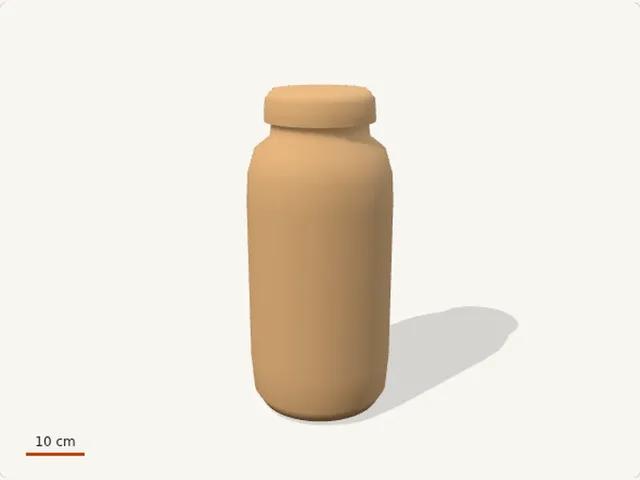
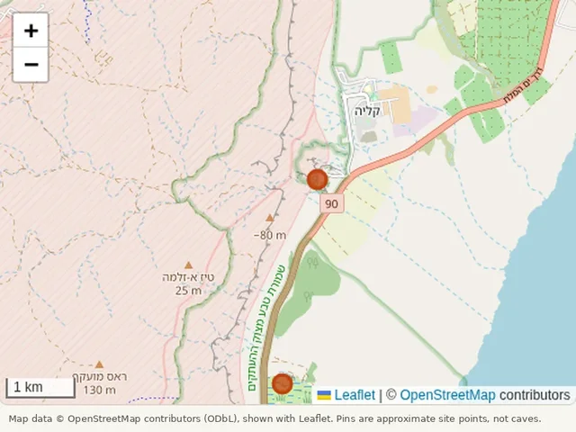
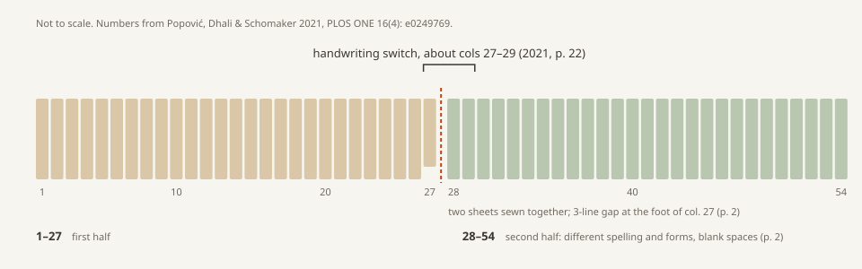
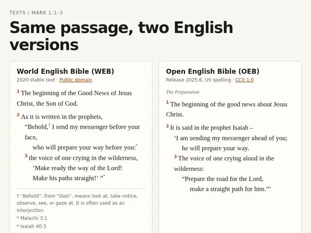

# Start here

A short route through what's in a/bible so far, if you've got half an hour or so. Four stops: an object, a place, a manuscript, a passage. Each one has a question to take with you. None of them has an answer here yet.

## 1. A jar

Open [the scroll jar](https://abstracts.co/a/bible/artifacts/jar) and turn it round. It's built from four numbers in the record for jar KhQ 1474, from a 1993 Library of Congress exhibition: the heights and diameters of the jar and its lid. Everything between those numbers is a guess, and [its sources](https://github.com/abstracts-co/bible/blob/main/artifacts/jar/SOURCES.md) say which parts. Then open [the cutaway](https://abstracts.co/a/bible/artifacts/jar-anatomy) for what a jar like this held: linen, a leather thong, a rolled scroll. That one is drawn from ranges across several objects, not from this jar.

**Take with you:** if most of the jar's shape is guessed, what would you need to look at to check it?

## 2. The caves

[The map](https://abstracts.co/a/bible/artifacts/qumran-map) has two pins, Khirbet Qumran and Ein Feshkha, and eleven caves with no pins at all. Use the cave list under the map anyway; it says what came out of each cave. The Israel Antiquities Authority's [discovery sites page](https://www.deadseascrolls.org.il/learn-about-the-scrolls/discovery-sites) is the next place to read.

**Take with you:** what kind of source would let us pin a cave entrance honestly?

## 3. One scroll, two papers

On [the source desk](https://abstracts.co/a/bible/artifacts/source-desk), read the 2021 card, then the 1QIsaa card. The 2021 paper argues from handwriting that two main scribes wrote the Great Isaiah Scroll, splitting around column 27. The 2025 paper dates both halves to the same period. If you'd rather read the papers themselves, the 2021 discussion is pp. 21–25 of [its PDF](https://journals.plos.org/plosone/article/file?id=10.1371/journal.pone.0249769&type=printable), and the 2025 paragraph on 1QIsaa is p. 7 of [that one](https://journals.plos.org/plosone/article/file?id=10.1371/journal.pone.0323185&type=printable).

**Take with you:** how much does the handwriting tell us that the sewn seam at column 27 didn't already?

## 4. Same words, different English

[Mark 1:1–3](https://abstracts.co/a/bible/artifacts/translation-desk) in two free English translations. Read the first two verses in both.

**Take with you:** which differences are English style, and which come from the text being translated?

## After that

[The timeline](https://abstracts.co/a/bible/artifacts/timeline) puts these in order, from the first Cave 1 finds to the 2025 paper. The IAA's [Leon Levy Dead Sea Scrolls Digital Library](https://www.deadseascrolls.org.il/explore-the-archive) has images of the fragments themselves.

If you've got a better fourth stop, or a fifth, suggest it on the Wall or open a PR with the guide-answer template.

*Images are our own renders and diagrams, and screenshots of our own artifacts. The map image shows OpenStreetMap data, © OpenStreetMap contributors (ODbL). The Mark image quotes the WEB (public domain) and the OEB (CC0). Details in [CREDITS.md](CREDITS.md).*
